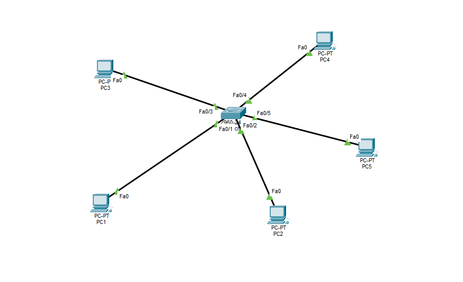
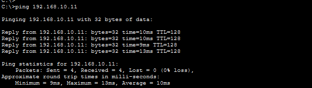
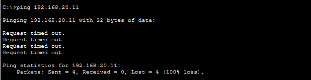

# VLAN Lab 03 — Create and Configure VLANs (Cisco Packet Tracer)

## Overview
This lab demonstrates how VLANs logically segment a single physical switch into
separate Layer 2 broadcast domains. PCs are divided across multiple VLANs
(ADMIN, SALES, and IT) on a single Cisco 2960 switch, and communication is tested
to show that hosts in different VLANs cannot communicate without Layer 3 routing.

## Topology

## Network Plan

| PC   | Switch Port | VLAN          | IP Address     | Subnet Mask     |
|------|-------------|---------------|----------------|-----------------|
| PC1  | Fa0/1       | 10 – ADMIN    | 192.168.10.11  | 255.255.255.0   |
| PC2  | Fa0/2       | 10 – ADMIN    | 192.168.10.12  | 255.255.255.0   |
| PC3  | Fa0/3       | 20 – SALES    | 192.168.20.11  | 255.255.255.0   |
| PC4  | Fa0/4       | 20 – SALES    | 192.168.20.12  | 255.255.255.0   |
| PC5  | Fa0/5       | 30 – IT       | 192.168.30.11  | 255.255.255.0   |

Default gateways are left blank — no router is configured in this lab.

## What This Lab Demonstrates
- Creating VLANs 10 (ADMIN), 20 (SALES), and 30 (IT)
- Assigning access ports to VLANs using `interface range`
- Verifying VLAN membership with `show vlan brief`
- Proving Layer 2 isolation: PC1 → PC2 succeeds, PC1 → PC3 fails

## Key Commands

**Create VLANs:**
Switch(config)# vlan 10
Switch(config-vlan)# name ADMIN
Switch(config)# vlan 20
Switch(config-vlan)# name SALES
Switch(config)# vlan 30
Switch(config-vlan)# name IT

**Assign access ports:**
Switch(config)# interface range fa0/1 - 2
Switch(config-if-range)# switchport mode access
Switch(config-if-range)# switchport access vlan 10

Switch(config)# interface range fa0/3 - 4
Switch(config-if-range)# switchport mode access
Switch(config-if-range)# switchport access vlan 20

Switch(config)# interface fa0/5
Switch(config-if)# switchport mode access
Switch(config-if)# switchport access vlan 30

**Verify:**
Switch# show vlan brief

## Verification

### VLAN Membership (`show vlan brief`)

VLAN 10 (ADMIN) lists Fa0/1 and Fa0/2. VLAN 20 (SALES) lists Fa0/3 and Fa0/4. VLAN 30 (IT) lists Fa0/5.

### Ping Test — Same VLAN (PC1 → PC2)

Result: **Success** — both hosts are in VLAN 10 and the same IP subnet.

### Ping Test — Different VLAN (PC1 → PC3)

Result: **Failure (expected)** — PC1 and PC3 are in different VLANs and subnets,
and no Layer 3 device routes between them. This confirms VLAN isolation.

## Repository Contents
- `switch1-running-config.txt` — Full switch running configuration
- Images — Network diagram and verification screenshots proving the lab works

## Check Your Understanding (Answers)
1. **What problem does VLAN segmentation help solve?**
   It reduces broadcast domain size, improves security by isolating traffic,
   and allows logical grouping of users regardless of physical location.

2. **Which command creates VLAN 30?**
   `vlan 30` (from global config mode).

3. **Which command assigns Fa0/5 to VLAN 30 as an access port?**
interface fa0/5
switchport mode access
switchport access vlan 30

4. **Why does PC1 fail to ping PC3?**
They are in different VLANs (10 vs 20) and different subnets. A Layer 2 switch
does not forward frames between VLANs; inter-VLAN routing requires a Layer 3
device (router or Layer 3 switch).
